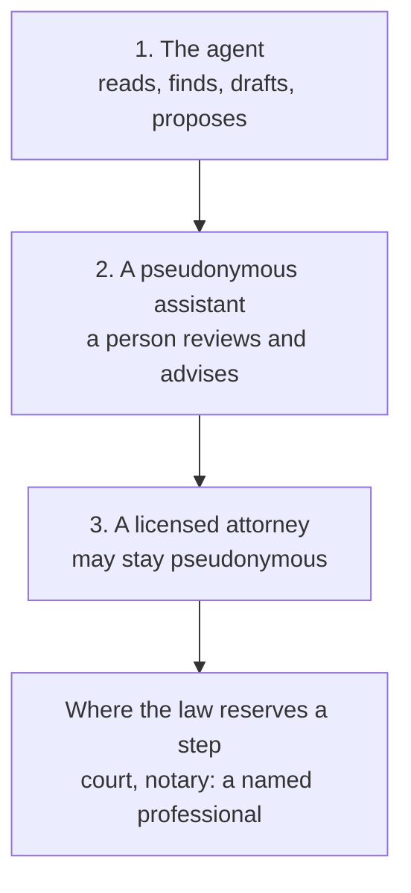

Most of legal work is reading. Find the provision, check it is still in force, compare it with the contract, draft the letter, note the deadline. A person who cannot afford an hour of that does without, and finds out about the deadline after it has passed.

Causius is built to do that part. It is an agent that works on a sealed case file, and it comes in three levels, each one a step toward a person with a licence.

## The three levels



| Level | Who | Today |
| --- | --- | --- |
| 1 | The agent | Works |
| 2 | A person under a pseudonym who reviews | Built as a helper role |
| 3 | A licensed attorney, pseudonymous if they choose | Built as a signed attestation |

The agent researches, records the deadline, drafts the letter and asks for your approval. It never sends or files anything. It is legal information, not advice, and it never represents anyone before an authority.

## The law it reads

Causius does not hold the law. It reads it, today straight from the official publishers: the Confederation's Fedlex, Liechtenstein's gesetze.li, and the cantonal collections. Every answer has to name the provision it rests on. A reply that cites nothing, narrates a search it never ran, or comes back in the wrong language is sent back to be corrected before you see it.

The law itself is moving into Solon, where it will be kept as data with its history. Causius will read it from there and cite both the publisher and the hash of the copy.

## Pseudonymous, and still licensed

A lawyer should be able to practise under a pseudonym if they choose, and you should still be able to know they are admitted. The honest version of that today is a **signed attestation**: a reviewer checked the admission against the official register, and the public sees that and nothing more unless the lawyer chooses to say more.

That is selective disclosure. It is not yet a zero-knowledge proof, and we will not call it one. A true proof needs a credential that a bar issues itself, in a form you can prove things about without showing it. None does. It is on the roadmap, and it depends on a bar.

## What it does not replace

Where the law reserves a step to a named professional, such as representation before a court or a notarial act, Causius says so and hands over. It replaces the reading, finding, comparing and drafting. It does not replace the signature.

```deep Under the hood: how an answer is checked
The agent loop has a small set of tools: web search, read a page, read a law,
check a domain, read a document, record a deadline, add a task, note a fact,
update the matter, draft a document, ask for approval. Every write is a
proposal; nothing leaves the case file by itself.

Before a reply is shown it is checked for four problems: narrated (it says it
searched when it did not), unsourced (no provision cited), unrecorded (a
deadline stated but not saved) and language (a question in English answered in
German). A failing reply is corrected up to twice, each time on a different
model. A last round forces an answer if the budget is spent, and the best
earlier answer is kept.

All of it runs on free models and on our own server. A live check runs the whole
loop against the real models and prints what they did.
```

```deep Under the hood: what the attestation says and does not
An attestation is a signed selective-disclosure token: the issuer, the register
entry it was checked against, the date, and only the claims the lawyer opted to
reveal. Anyone can verify the signature. Nobody can learn more than was
disclosed.

It does not prove the lawyer is currently in good standing beyond the date of
the check, and it does not hide that a reviewer, a person, looked at the
register. A bar-issued credential would remove that trust in the reviewer; until
then the record states the limit rather than hiding it.
```

It is built in public and the code is open. Anyone can start their own.

Legal help should be easy to reach and honest about where it stops.
