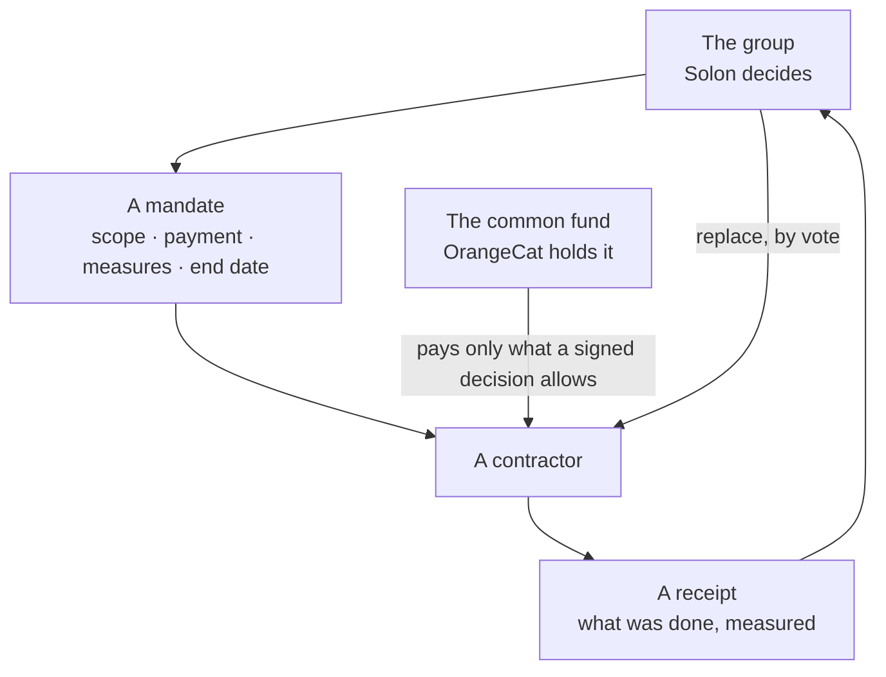

When a unit of government grows past the point where the people in it can see what it does with their money, its decisions stop being theirs. New York's five boroughs are each larger than most American cities, and none of them is a city. Los Angeles is one. Nobody chose that; it accreted.

The remedy is old and has a name in Zürich: functional, overlapping, competing jurisdictions. Smaller units, each with a budget, that people can compare with the next one and leave. What has been missing is not the idea. It is a cheap way for a group of neighbours to start one.

## A place does not have to tax to have a budget

Witikon is a quarter of the city of Zürich. It is not a tax authority and has no reason to become one. But anyone can found it as a place in Solon, with a common fund. People give. The group decides what the money is for. It is spent in the open, the way a commune's budget is.

The money is not the point. A group that has a budget finds out that it can govern itself, and it can read what Zollikon or Küsnacht do with theirs and do better, or differently. Solon already maps every Swiss commune and colours it by the income tax at your income. The same pages are where a founded place sits beside the places that exist.

## Government as a set of contracts

A town can hire a company to manage it. That company hires others for waste, for security, for sanitation. Each of those is a contract with measures of success. The group pays for results, and replaces a contractor that fails.

In Solon's terms a contract is a **mandate**: who, to do what, paid how, judged by which measures, until when. A decision creates it, a report comes back to the record, and a failed one is replaced by a vote. The state stops being the thing you cannot change and becomes a set of mandates you can.



## What exists and what does not

This is the part to read twice. Most of the above is a plan.

| Piece | Today |
| --- | --- |
| Every Swiss commune on a map, with its income tax | Live |
| Liechtenstein's eleven communes, by name and postcode | Live since this week |
| Anyone may found a group; signed votes; an append-only record | Live |
| A treasury you can watch | Live, and watch-only by design |
| A founded place with a common fund | Planned |
| The budget as a decision the group votes | Planned |
| Mandates with success measures, replaceable by vote | Planned |
| One list of the kinds of group: a town, a company, a network state | Planned |

The roadmap in the repository says the same, with the order.

```deep Under the hood: who moves the money
Solon never spends. Its treasury is a label and an address with no code path
that can send anything, on purpose. A common fund therefore lives where money
lives: in OrangeCat, which holds wallets. A closed Solon decision is evidence,
not authority. The executor that holds the money checks the signatures itself
before it moves a satoshi, so a compromised Solon cannot spend a fund.

A mandate's measures (who defines them, who reads them, who may dispute a
reading) are rules of the group. They belong in its charter as data, amended by
its own votes, not in code.
```

```deep Under the hood: states, founded places and proposed ones
Solon's places table already separates the origin of a jurisdiction: `state`
(it exists, an importer records it), `founded` (a group made it, and its name
and rules come from its organization) and `proposed`. A founded place claims no
more than it says it does; the badge reads "founded", never "state".

What is missing is one list, in configuration, of the kinds of group and what
each must declare: how it decides, who belongs, whether it holds money, and
what territory, if any, it claims. A town, a company, an association, a network
state and a charter city would then be one kind of thing at different sizes.
```

The aim is to make it easy and pleasant for people to cooperate by choice, and hard to rule people who did not choose their rulers and cannot replace them. It is built in public and the code is open, so anyone can start their own.

A group that has a budget finds out it can govern itself.
