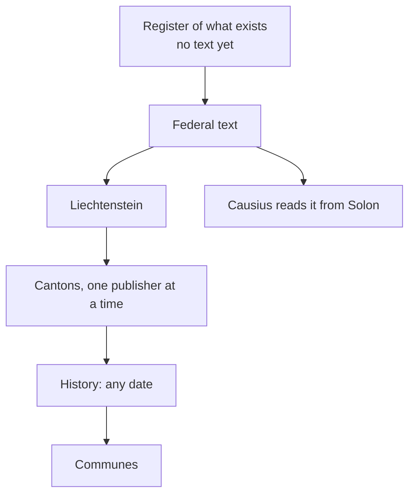

If you want to know what binds you, you should be able to read it. In Switzerland you can, if you know that the Code of Obligations is on the Confederation's site, that the rent rules of Zürich are on the canton's, and that your commune has its own regulation somewhere else.

The law is public. It is not in one place, and that is the problem we are working on.

## The goal

Every law and every regulation in force in every authority of Switzerland and Liechtenstein: the Confederation, the 26 cantons, Liechtenstein and, in the end, the communes. Stored as the publisher published it, with who enacted it, from when to when it was in force, and a hash that proves the copy is the publisher's. Served openly, so that any app and any person can read it.

Tax law came first, as a model of how a place taxes income. That is a model of one law. This is the law.

## How big it is

We counted on 22 October 2026, from LexFind's own statistics.

| Authority | Active texts |
| --- | ---: |
| Confederation | 5,339 |
| The 26 cantons together | 16,389 |
| **Switzerland, federal and cantonal** | **21,728** |
| Liechtenstein | not counted yet |
| About 2,100 communes | not counted |

Counting repealed texts, the total is 33,105. Fedlex's own register lists 13,257 entries, against LexFind's 6,771 federal ones including repealed. We do not yet know why the numbers differ, so neither is the target until we do.

## Order of work



Each step ships alone and its coverage is a number on a page. Nothing is described as covered that the page does not count. None of it is built yet; the first step is the register.

## What it will not do

It will not interpret, summarise or translate as law. A summary is a different thing with a different label. If a copy ever stops matching its publisher, the reader is sent to the publisher, and the publisher wins.

```deep Under the hood: the data model
An act is a stable work: who enacted it, what kind it is (constitution,
statute, ordinance, regulation, treaty, decree), and the identifiers it goes
by, because one act has many: the federal systematic number, the cantonal
number, the Liechtenstein one, and the index's own.

A version is one consolidated text in one language, in force from one date to
another, with the publisher's URL and the sha256 of the bytes we fetched, and a
flag that says whether it is the authentic publication or a consolidated
reading. A provision is one article of a version, so an article is one lookup.
Nothing is deleted: a repealed act stays, with the date it ended.

Where an act applies is not stored. It applies in the place that enacted it and
in every place inside it, and the place chain answers that.
```

```deep Under the hood: reading publishers kindly
Each publisher is read by its own reader. Fedlex gives versions and dates by
query and the text by file. The cantons are taken one publisher at a time, with
LexFind as the register of what exists, because a PDF loses structure: margin
notes run into headings and words are hyphenated.

Liechtenstein's host answers a burst of requests with a proof-of-work page. We
do not get around it. We slow down, cache what we have, and fetch less. Every
reader identifies itself, limits its rate, and keeps snapshots so that nothing
is fetched twice.
```

```deep Under the hood: what is licence and what is service
Acts and official decisions are not protected by copyright in Switzerland
(Article 5 of the copyright act) nor in Liechtenstein. An index or a text
extraction by a third party is a service, with terms of its own. Before any bulk
import from LexFind we read them, or take each canton's own publication
instead.
```

It is built in public and the code is open. Anyone can start their own.

The law is public. It should also be findable.
