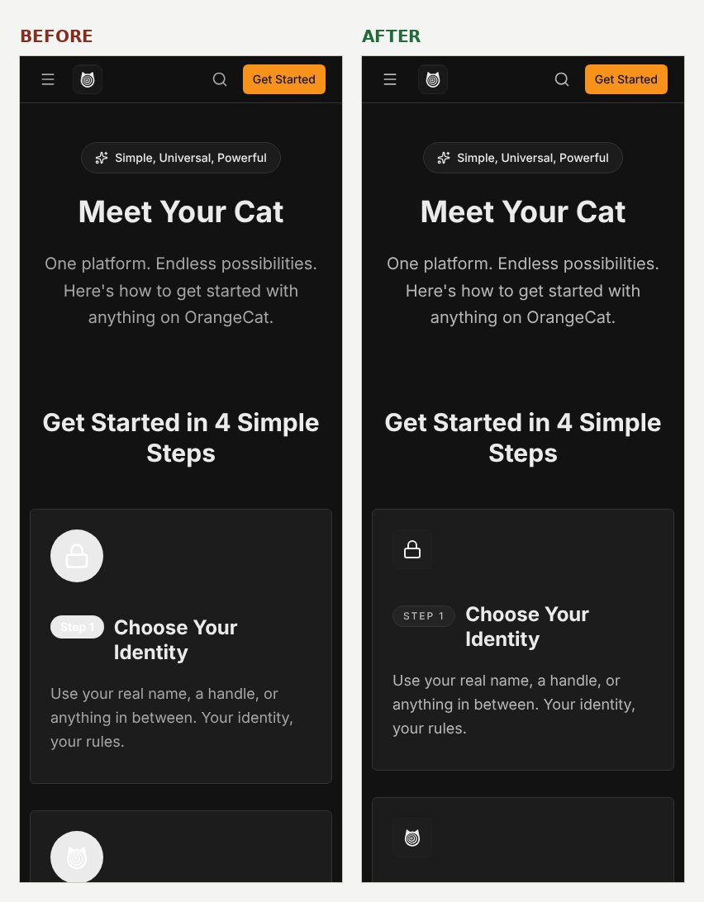
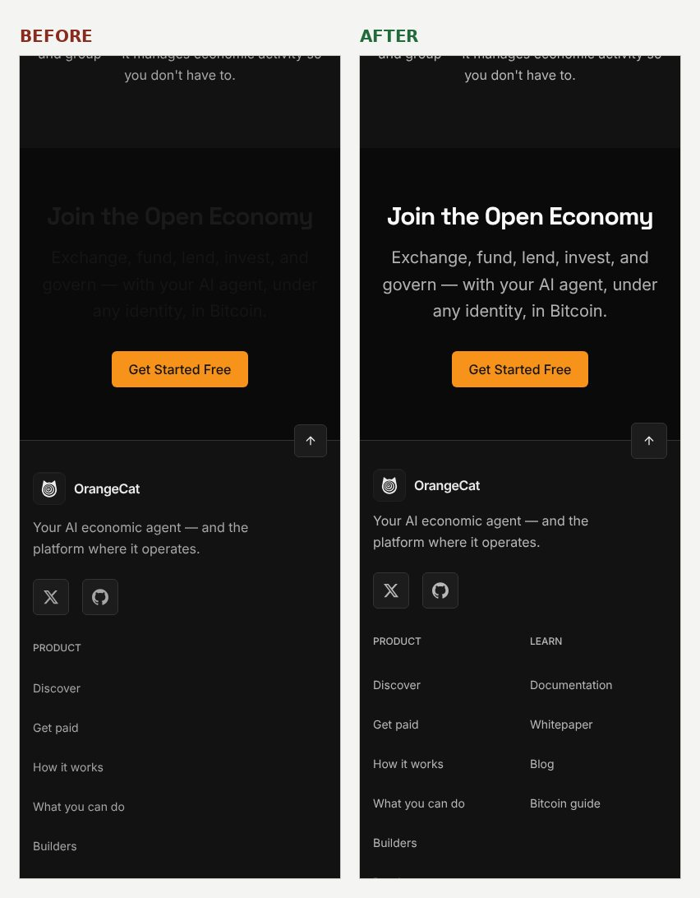
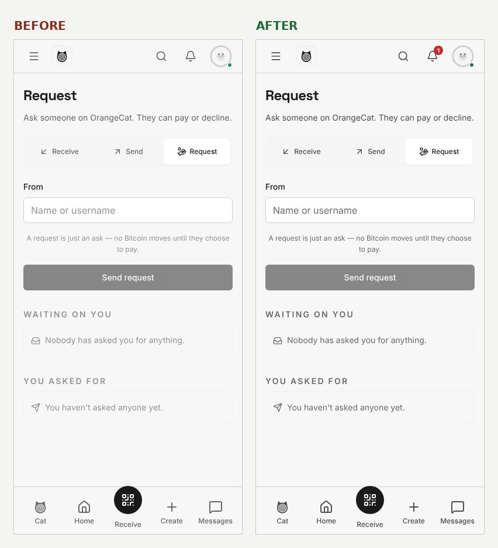
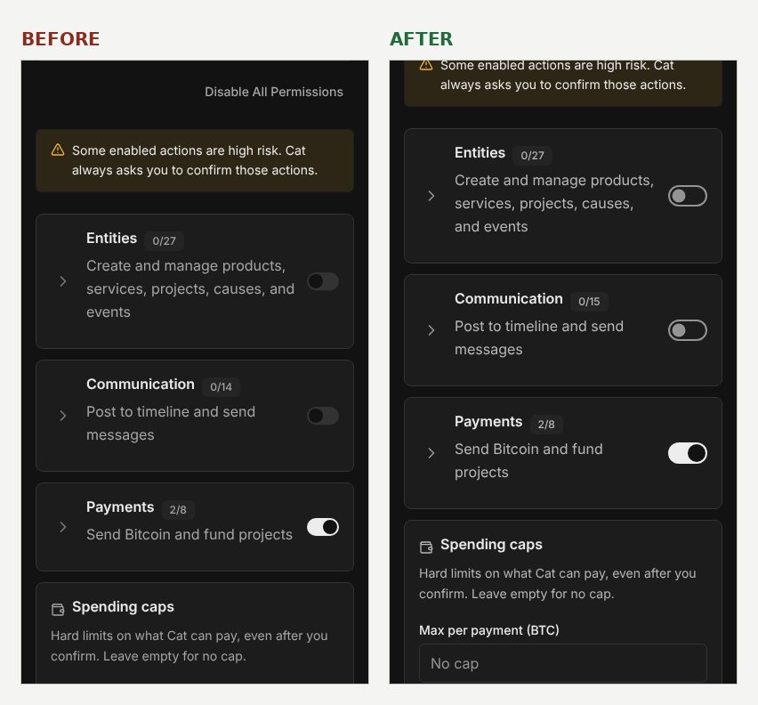
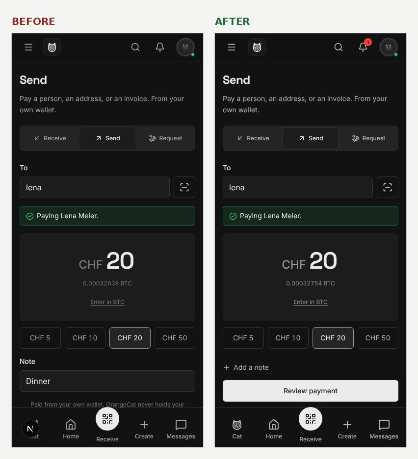
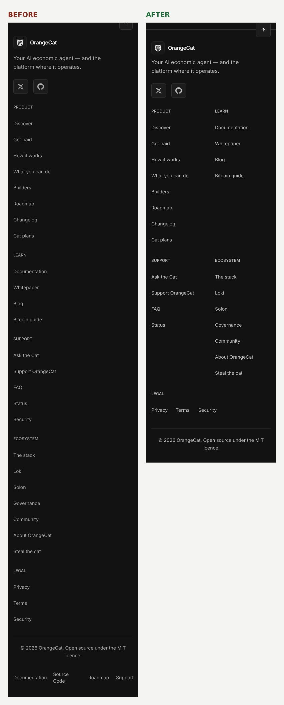
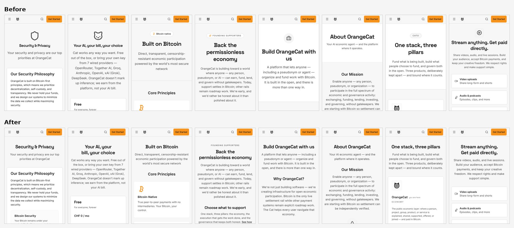
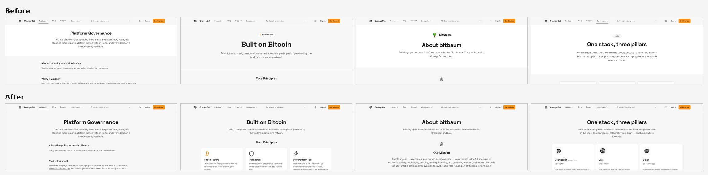
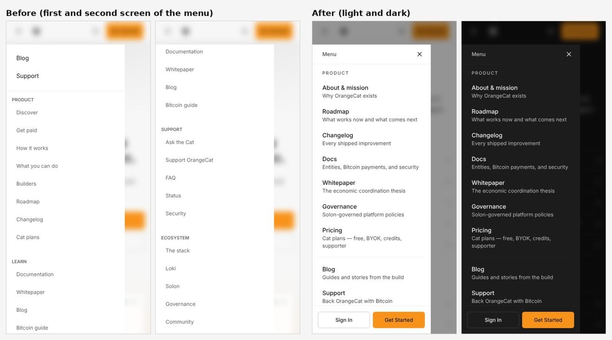

# UX/UI audit — 2026-11-12

A measured audit of OrangeCat's public site and signed-in app, the fixes that
shipped from it, and what is still open. Screens were opened in a real browser
(Chromium through Playwright) at 390px and 1440px, in dark and in light, and
every finding below was re-checked by a second reviewer before anything was
changed.

## Summary

- **Measured:** 99 pages at phone and desktop width, in dark and light. No page
  scrolled sideways. 1,729 elements were below the 4.5:1 contrast minimum,
  1,438 tap targets on a phone were under 44px, and some text could not be
  read at all in the default dark theme.
- **Found:** 140 problems across ten areas. A second reviewer re-checked each
  one: 60 stood as written, 80 were corrected, none were thrown out.
- **Shipped:** [#1634](https://github.com/bitbaum/orangecat/pull/1634) fixes the causes that touch every page. Measured again on
  the branch: 0 elements below 4.5:1, 119 small tap targets, every page with
  one `h1`. 32 findings are fixed and 9 partly fixed. Some of those were
  fixed on `main` by other changes while this was in review (#1625, #1629,
  #1630, #1631), and this change was merged over them.
- **Second batch:** a second pull request gives every public page one header
  and rebuilds the visitor menu on a phone; it fixes four more findings (see
  "Second batch" below).
- **Fourth batch:** the 104 findings still open were each re-checked against
  main and worked: 86 fixed, 15 fixed in part (each says what is left), 2
  already fixed on main, 1 belongs in another repository (see "Fourth batch").
- **Fifth batch:** the four decisions left open, made on 2026-11-13; five of
  the "Partly" findings are now fixed. The package releases that followed
  fixed two more and `chrome#13`, so eight remain partly fixed.
- **Still open:** the parts of eight findings listed in the tables as
  "Partly"; each says what is left.
- **Owner decisions:** five, made and shipped in a third pull request (see "Owner decisions, made").

## How it was measured

- **Pages.** 99 routes: 59 public pages (landing, sign-in, Discover and every
  public listing, detail pages, content and legal pages, the 404) and 40
  signed-in pages (dashboard, Cat, money, messages, create and manage,
  settings, profile).
- **Captures.** Each page at 390×844 and 1440×900, in dark and light: 396
  captures of the local app, plus 24 of production for the pages a sandbox
  cannot serve without the server key (`/pay/<username>`, project detail,
  Discover search).
- **Signed-in pages** were opened as a brand-new pseudonymous account made
  with the product's own "Start instantly — no email" button, so they show
  the first-run experience. Nothing was posted, saved or paid.
- **Measurements per capture:** horizontal overflow, interactive elements
  under 44×44px, axe-core WCAG 2.x AA violations with computed colours, text
  under 12px, heading structure, console errors and failed requests.
- **Review.** Ten areas, one reviewer each, judged against `AGENTS.md`
  ("Design system", "One shape per kind, here") and the fleet rules ("No dead
  ends", "One shape per kind"). A second reviewer then tried to refute every
  finding by opening the same evidence and the code, and corrected severity,
  cause and fix where they were off. Of 140 findings, 60 were confirmed as
  written, 80 were corrected, none were thrown out.

The default theme is dark (`ThemeProvider` sets `defaultTheme="dark"`), so
dark is what a first-time visitor sees. Light was held to the same bar.

## Baseline

Measured before any change, on `main` at `0275875`:

| Measure                                  | Dark 390 | Dark 1440 | Light 390 | Light 1440 |
| ---------------------------------------- | -------: | --------: | --------: | ---------: |
| Pages captured                           |       99 |        99 |        99 |         99 |
| Pages with sideways scroll               |        0 |         0 |         0 |          0 |
| Text below 4.5:1 contrast (elements)     |      372 |       479 |       385 |        493 |
| Pages with at least one contrast failure |       44 |        97 |        42 |         97 |
| Interactive elements under 44px          |    1,438 |       n/a |     1,438 |        n/a |
| Buttons with no accessible name          |       22 |        22 |        22 |         22 |
| Pages with no `h1`                       |        9 |         6 |         9 |          6 |

Three causes explain most of it:

1. **One text token.** `--text-tertiary` measured 4.36:1 on the page and
   3.97:1 on a card in dark, and 2.83:1 and 3.03:1 in light. It is used in 486
   places and caused 81% of all contrast failures.
2. **Ink that does not follow its fill.** White text written by hand on fills
   that flip with the theme (the "Step" badges on How it works: white on
   near-white, 1.19:1), theme-following ink on a band that is always dark
   (the closing banner on About, Docs, Security and Domains: 1.08–1.13:1),
   and white on orange (2.3:1), which the `check:accent-ink` gate could not
   see because it only matched one spelling of the orange class.
3. **Three shared lines.** Footer links at 36px, the header logo link and
   "Back to top" accounted for 82% of the small tap targets.

## What shipped

One pull request, [#1634](https://github.com/bitbaum/orangecat/pull/1634): the causes that touch every page, each with a
gate so the class of bug stays closed.

### Measured before and after

The same 99 pages, captured again on the branch:

| Measure                                                                    |                Before |         After |
| -------------------------------------------------------------------------- | --------------------: | ------------: |
| Text below 4.5:1, elements (dark 390 / dark 1440 / light 390 / light 1440) | 372 / 479 / 385 / 493 | 0 / 0 / 0 / 0 |
| Pages with at least one contrast failure (same order)                      |     44 / 97 / 42 / 97 | 0 / 0 / 0 / 0 |
| Interactive elements under 44px at 390                                     |                 1,438 |           119 |
| Buttons with no accessible name                                            |                    22 |             0 |
| Links in a sentence told apart by colour alone                             |                     6 |             0 |
| Pages with no `h1` at 390                                                  |                     9 |             0 |
| Tab strips pointing at panels that do not exist                            |                     1 |             0 |
| Progress bars with no name                                                 |                     1 |             0 |
| Pages with sideways scroll                                                 |                     0 |             0 |

Measured at commit `a8979af`, before the last merge of `main`. Of the 119
remaining small targets, 43 are the 40×44px actions under a post on the
dashboard, timeline and community feeds, 17 are switches (the box is 44×24,
the hit area is 44×44), and 12 are native checkboxes and radio buttons.
Unchanged and open: two `aria-hidden-focus` on `/builders` and `/partners`,
and three scrolling code lines without a tab stop.

### Colour

- **Text ramp.** Secondary and tertiary text moved (light 40% → 30% and
  58% → 42%; dark 65% → 72% and 48% → 58%), so each clears 4.5:1 on every
  surface in both themes. Primary is unchanged. The hero's second tone uses
  tertiary so the two-tone headline keeps its step.
- **Status colours as words.** The status tokens are tuned to be read as
  text, on a card and on their own tint. Fills read separate `-fill` tokens
  (`bg-status-*` in `tailwind.config.ts`), so a danger button stays red and a
  warning bar stays amber. Ink on a fill: `text-fg-inverted` on positive and
  negative, `text-warning-foreground` on warning.
- **`text-on-public`.** The band that is near-black in both themes has its own
  ink. `text-fg-inverted` flips, and vanished on it in dark.
- **Ink follows its fill.** Fills that flip with the theme carry
  `text-fg-inverted` instead of a hand-written white; orange fills carry
  `text-on-accent`. The How it works steps are one neutral shape.
- **No dimmed copy.** `text-fg-muted` and resting alpha on text are gone from
  words (65 lines); article and FAQ links are ink with a full-strength
  underline.

### Structure and touch

- **Footer.** Links are 44px on a touch screen, the phone footer is two
  columns and about a third shorter, and the bottom bar that repeated four
  links is gone.
- **Switch.** A 44×44 hit area; off is an outline and on is a fill, so the
  state does not rest on the thumb's position. The Cat permission switches
  and their expanders have names.
- **Send.** "Review payment" sat underneath the phone tab bar after a person
  and an amount were chosen. It stays above the bar now, and returns to the
  bottom edge while the keyboard is up.
- **Headings and landmarks.** One `h1` on sign-in at phone width, the Cat
  chat and route errors; empty states and footer columns are `h2`; no nested
  `<main>`; one home link in the header.
- **Controls.** Select and dropdown rows, tabs and the icon button are 44px
  on touch. Entity list tabs that pointed at panels which do not exist are a
  segmented control, and its selected cell has an edge in dark. Progress bars
  announce a value.

### Motion, focus and type

- A focus outline in forced-colours mode, where the ring (a box-shadow) is
  removed by the browser.
- Smooth scrolling only without `prefers-reduced-motion`, in the stylesheet
  and at every scripted scroll (`src/lib/scroll-behavior.ts`).
- Headings no longer auto-hyphenate ("permission-less", "al-ready").
- 10px text on phones is 12px.

### Fixed on main while this was in review

Four changes from another session landed first, and this one was merged over
them rather than replacing them:

- #1629 moved tertiary text to 44% and 55%, which clears 4.5:1 on page, base
  and raised. This change keeps 42% and 58%, which also clears it on
  `surface-overlay`, and moves secondary so the two tones stay apart.
- #1630 removed the "Bitcoin Integration: Outage" row that nothing measured
  from the status page. Its version stands.
- #1631 gave the pay card dark ink on orange. Its buttons on the wallet guide
  and Study Bitcoin stay orange.
- #1625 gave every not-found page one `h1` from a shared view. Its version
  stands.

### Gates added

| Gate                         | Holds                                                                                                                                                                                      |
| ---------------------------- | ------------------------------------------------------------------------------------------------------------------------------------------------------------------------------------------ |
| `check:token-contrast`       | 124 text, status and ink pairs at 4.5:1 in both themes, read from `globals.css`                                                                                                            |
| `check:accent-ink` (widened) | no light ink on orange, no white on a flipping or status fill, the right ink on the warning fill, no accent class that draws nothing, no dimmed copy; also across a multi-line `cn()` call |
| `check:tap-targets`          | a compact `min-h` on a raw link or button carries `pointer-coarse:min-h-11`                                                                                                                |
| `check:type-scale` (widened) | reads `.css` as well, and ratchets `text-2xs`                                                                                                                                              |

Seven public pages were added to `check:broken-words` and taken out again
before merge: with 39 screens in place of 18 the step ran for 20 minutes
without finishing, and its CI job stops at 25. The hyphenation rule is held
by a unit test on `globals.css` instead.

### Reviewed before shipping

Five reviewers read the diff (code, public screens, signed-in screens,
accessibility, design rules). Their findings that were acted on: the status
tokens were doing double duty as text and fill (danger buttons had turned
salmon in dark and warning bars brown in light), the switch's off state had
become a solid pill, the example prompts under "What do you want to do?"
read as input fields, the selected segment was weaker in dark than the tab
it replaced, and the changelog claimed more than the change held. The
accessibility reviewer and two second-pass checks did not run (the account's
usage limit was reached), so the accessibility result rests on the
measurements above, not on a separate review.

## Second batch: one header for public pages, and the visitor menu

A second pull request, opened after the first. It takes the two findings about
public page frames (`content#6`, `funnel#7`) and the two about the visitor
menu (`chrome#0`, `chrome#3`).

### One header for every public page

Thirty public pages each built their own first screen: titles from 24px to
60px, centred on some and left on others, an icon above one title, a pill
above another, a raised band behind a third, and six different content
widths. They now open with one component,
`src/components/layout/PublicPageHeader.tsx`:

- **One title scale** (30px on a phone, 36px, then 48px on a desktop), one
  lead line under it, the same space above and below.
- **Nothing above the title but an optional label.** The shield on Security,
  the cat on Pricing, the briefcase on Careers, the play tile on Channel, the
  logo on About bitbaum and the pills on How it works, Technology and
  Ecosystem are gone. "Founding supporters" and "Open source · MIT" stay as
  the label, because they say what kind of page it is.
- **No band behind the header.** It sits on the page surface everywhere.
- **Two alignments, by kind.** A page about OrangeCat is centred. A document
  read top to bottom (the legal pages, the whitepaper, the changelog, the
  roadmap, the two docs sub-pages) starts at the left of its column, and so
  does "What you can do", whose header ends in a prompt.
- **Two page widths**, `reading` (768px) and `wide` (1152px), in place of six.
  Security's three-card row became two at the narrower width.
- The three titles that were set in the body typeface (Articles, a blog post,
  "What do you need?") use the heading face.

The titles and lead lines themselves are unchanged. `check:public-frame` fails
a page under `src/app/(public)` that writes its own `<h1>`, uses the signed-in
`PageHeading` directly or wraps itself in `PageLayout`; five pages are exempt
by name with the reason (a post, an article, the articles list, the two
payment screens).

### The visitor menu

On a phone the public menu showed "Blog" and "Support", dropped the Product
and Ecosystem groups (they have children and no link of their own, so they
rendered nothing), listed the whole footer in their place (27 links, 1,681px
in a 780px panel) and offered no Sign in anywhere in the public chrome. It was
a plain `div`.

- It lists the header's own destinations in their groups, each with the line
  that says what it is, and ends with Sign In and Get Started as two equal
  cells. The footer is not repeated; it is on the page.
- It is a modal dialog: a close button, a dimmed page behind it, keyboard
  focus kept inside while it is open and returned to the menu button after.
  The menu button says whether the menu is open and now closes it too.

### Also in this batch

- The code samples on "Sign in with OrangeCat" and the command on "Steal the
  cat" scroll sideways; a keyboard could not reach them to scroll. They take
  focus now.
- The first section heading on How it works was the same size as the page
  title on a phone. It is one step smaller.

### Measured

Thirty pages at 390px and 1440px in light, and at 390px in dark, plus the open
menu in both themes: no sideways scroll, one `h1` on each, and no axe
violation. `/blog` (6) and `/study-bitcoin` (4) still have targets under 44px
at 390px; both were there before and another open pull request (#1643) is
about those two pages.

This batch was not read by a second reviewer: the account's sub-agent limit
was reached while it was being built, so it rests on the captures, the gates
and 20 new unit tests.

### Findings other pull requests are fixing

While the first pull request waited for CI, other sessions opened about 55
pull requests against the same repository. Two of the ten areas were checked
against their diffs (one reading, not re-checked; the run stopped at the same
limit):

| Finding            | Pull requests                  | What is left                                                                                    |
| ------------------ | ------------------------------ | ----------------------------------------------------------------------------------------------- |
| `app-shell#0`      | #1654 (merged)                 | The phone drawer ends above the tab bar now. It still stays open after a destination is picked. |
| `app-shell#12`     | #1655 (merged), #1651          | The "Switch context" button in the sidebar is still about 32px.                                 |
| `auth-firstrun#2`  | #1656 (merged), #1665          | The onboarding text box is still 241px wide beside its microphone.                              |
| `auth-firstrun#3`  | #1653 (merged)                 | "56% set up" is gone. The dashboard still tells a new account "No pending Cat approvals."       |
| `auth-firstrun#4`  | #1667                          | Nothing, once it merges.                                                                        |
| `auth-firstrun#10` | #1667                          | Empty fields and a password mismatch still go to the banner, not the field.                     |
| `auth-firstrun#13` | #1655 (merged), #1656 (merged) | The three password-reset screens keep their own card, icon tile and Title Case headings.        |

## Fourth batch: every remaining finding

After the owner decisions, the 104 findings still open were split by area
across nine parallel workers. Each re-checked its findings against main (about
45 other pull requests had merged since the audit), fixed what was still
broken, added tests where a test can hold the fix, and committed. The nine
branches were merged into one pull request and resolved by hand where two
areas had fixed the same thing differently (the dashboard's status line, the
Create menu, the account menu, the sign-in/sign-up choice). `pnpm run verify`
passes on the result: 813 test files, 6,614 tests.

The largest changes a person will notice:

- **Signing up and in:** one orange button per screen, errors under the
  field they belong to, one landing rule for every way in, and password
  reset in the same frame as sign-in.
- **The phone:** the drawer closes when you pick a page; the visitor tab bar
  offers Sign in; the Create sheet uses plain verbs and shows the page's own
  kind first; the tab bar's money slot is "Money" everywhere.
- **Money:** buttons wait for an amount within the limits, the pay page says
  who you are paying, and Send leads straight to connecting a wallet.
- **Discover and listings:** a listing whose owner has no wallet offers a way
  to ask how to pay; prices and the book button lead the page; breadcrumbs
  stay public.
- **Settings and the Cat:** permission rows in plain words, payments not
  shown as on when they are off, Account in five sections, a Preferences
  page, spending caps entered in your currency.
- **Public pages:** one start band, pricing that lines up, the blog and
  changelog reorganised, three duplicate pages redirected.
- **Design gates:** `check:one-orange` keeps in-app orange buttons and orange
  words at zero; `check:choice-rows` now also catches radio rows.

## Owner decisions, made

Found during the audit as product or data decisions rather than design
fixes. On 2026-11-12 the owner handed them over ("you make them and execute");
each was decided and shipped in a third pull request.

1. **Tasks are seen by their creator and by whoever is asked.** Any signed-in
   account could read and update every non-archived task, read every
   completion and flag, and read requests sent to "everyone"; the request and
   flag routes notified every account on the platform. Migration
   `20261113120000_a_task_is_seen_by_its_creator_and_whoever_is_asked.sql`
   scopes tasks, completions, flags and requests to the task's creator and the
   person a request names; a request must name a person, chosen with the same
   people picker as the money screens; the broadcast helper is removed. Tested
   against Postgres 16 as the creator, the person asked and a stranger: the
   stranger sees and changes nothing.
2. **Saving a Cat spending cap leaves payments as they were.** The cap is
   written on the payments category row with its current on/off state (or the
   category default, off, when there is no row), so Send Payment and the rest
   no longer move from Off to "Ask first". A unit test fails on the old code
   and passes on the new.
3. **The three QA listings are marked as test data.** Migration
   `20261113121000_three_qa_listings_are_marked_as_test_data.sql` sets
   `is_test` on "QA test product", "QA Test Project" and "QA Test Service" by
   id; nothing is deleted. The account "QA Grok A" is a person's account and
   was left alone.
4. **"What it solves" comes before the studio on the home page.** On a phone
   it sat under about 4,100px of studio products.
5. **The shared token package takes OrangeCat's values.**
   [bitbaum/design-tokens#64](https://github.com/bitbaum/design-tokens/pull/64)
   moves tertiary to 42% / 58% and secondary to 30% / 72%: the package's 44% /
   55% read 4.32:1 and 4.20:1 on the overlay surface. Its contrast test now
   checks overlay.

## Findings by area

Severity is the second reviewer's. "Corrected on re-check" means the finding was real and its severity, cause or fix was wrong as first written. The cause and fix for every open finding are in the per-area files:

- [Landing page and marketing funnel](2026-11-12-ux-ui-findings-funnel.md): 0 partly open of 14
- [Sign-in, sign-up and the first five minutes](2026-11-12-ux-ui-findings-auth-firstrun.md): 3 partly open of 14
- [Global chrome and interaction states](2026-11-12-ux-ui-findings-chrome.md): 1 partly open of 14
- [Discover, public listings and public detail pages](2026-11-12-ux-ui-findings-discover.md): 2 partly open of 14
- [Money surface: pay, receive, send, requests, wallets, finances](2026-11-12-ux-ui-findings-money.md): 2 partly open of 14
- [Signed-in shell, dashboard and social surfaces](2026-11-12-ux-ui-findings-app-shell.md): 4 partly open of 14
- [Create and manage flows](2026-11-12-ux-ui-findings-create-manage.md): 2 partly open of 14
- [Profile and settings](2026-11-12-ux-ui-findings-profile-settings.md): 0 partly open of 14
- [Content and long-tail public pages](2026-11-12-ux-ui-findings-content.md): 2 partly open of 14
- [Systemic accessibility and design-system issues (measurement-driven)](2026-11-12-ux-ui-findings-systemic.md): 0 partly open of 14

### Landing page and marketing funnel

The first screen is strong: one statement, one warm action, a real mark, readable in both themes at 390px, and no page in this surface overflows sideways, has a console error or lacks a visible focus ring. After that screen the funnel loses the visitor. Two sibling pages have content that cannot be read in the default dark theme, the home page puts 4,112px of other studio products between the hero and what OrangeCat does for the visitor, and the hero button and every public "Start" greet a first-time visitor with "Welcome back, sign in". The six sibling pages each have their own header frame, their own name for the sign-up action and their own closing band; three exceed 11,000px on a phone, largely through repetition. Fix first: (1) the invisible content in dark, namely the step badges on /how-it-works (also confirmed on production) and the closing band on /about; (2) the path, so that hero and Start links open the register form and "What it solves" comes directly after the hero; (3) the grey text tokens that fail AA on 32 to 67 nodes per page.

| #         | Severity | Finding                                                                                                                                 | Where                                        | Status                      |
| --------- | -------- | --------------------------------------------------------------------------------------------------------------------------------------- | -------------------------------------------- | --------------------------- |
| funnel#0  | high     | How it works: step numbers and step icons are invisible in the default dark theme                                                       | /how-it-works                                | Fixed (#1634)               |
| funnel#1  | high     | About: the closing call to action has no readable heading or sentence in dark                                                           | /about                                       | Fixed (#1634)               |
| funnel#5  | high     | Readable sentences are set in text-fg-tertiary and text-fg-muted, which fail AA in both themes (corrected on re-check)                  | /, /what-you-can-do, /ecosystem, …           | Fixed (#1634)               |
| funnel#2  | medium   | A first-time visitor who taps the hero action or any 'Start' is greeted with 'Welcome back, sign in' (corrected on re-check)            | /, /what-you-can-do, /how-it-works, …        | Fixed (fourth pull request) |
| funnel#3  | medium   | Home on a phone: 4,112px of other studio products sit between the hero and what OrangeCat does for you (corrected on re-check)          | /                                            | Fixed (fourth pull request) |
| funnel#4  | medium   | 'How it works' never says how it works, and half of it repeats another page (corrected on re-check)                                     | /how-it-works                                | Fixed (fourth pull request) |
| funnel#6  | medium   | Pricing: orange is a border, a 'not open yet' badge and three buttons, and the warm action is on the wrong plan (corrected on re-check) | /pricing                                     | Fixed (fourth pull request) |
| funnel#7  | medium   | Six sibling pages, six page-header frames (corrected on re-check)                                                                       | /how-it-works, /what-you-can-do, /pricing, … | Fixed (second pull request) |
| funnel#8  | medium   | One action, six names; closing bands differ and one page ends by sending the visitor to another product (corrected on re-check)         | /, /how-it-works, /what-you-can-do, …        | Fixed (fourth pull request) |
| funnel#9  | medium   | What you can do: two identical rows of wrapping pills do different things, and their labels sit off-centre                              | /what-you-can-do                             | Fixed (fourth pull request) |
| funnel#10 | medium   | Capability cards: the action is a 51x36 text link, and 'See yours' is offered to people who have nothing yet                            | /what-you-can-do, /how-it-works              | Fixed (fourth pull request) |
| funnel#11 | medium   | The stack page publishes internal scratch entries as products                                                                           | /ecosystem, /                                | Fixed (fourth pull request) |
| funnel#12 | low      | The public 'What do you want to do?' box has no microphone; the signed-in one does (corrected on re-check)                              | /what-you-can-do                             | Fixed (fourth pull request) |
| funnel#13 | low      | About does not say who builds OrangeCat or how to check (corrected on re-check)                                                         | /about                                       | Fixed (fourth pull request) |

Keep: Home hero (src/components/home/sections/HeroSection.tsx, .oc-public-hero* in globals.css): one statement, one accent action with dark text-on-accent ink, full-width 48px buttons on a phone, and everything through the two actions visible in The 'What it solves' picker (ProblemsExplorer.tsx): problems in the person's own words, one answer open at a time, the action label and href read from the entity registry, 44px targets, correct tab semantics. The pulse under the hero shows server-counted numbers and omits any it cannot fetch (HomePulse.tsx). Context survives sign-in: the middleware carries the full path and the typed sentence (?q=) in from= through /auth, and useAuthForm.ts honours it for email, OAuth and the anonymous start.

### Sign-in, sign-up and the first five minutes

Sign-in and the first five minutes are solid underneath (no horizontal overflow, visible focus, 44-48px main buttons, no dead buttons, a pseudonymous way in), but the path is not designed as one path. The sign-in screen shows two orange primaries and six ways in, and the first orange one creates a new account under the heading "Welcome back". A new person then lands on one of three different first screens depending on the button they used, and the only real onboarding form is reached by accident and has a visibly broken main field. The first-run dashboard and Cat chat speak to someone who already has things ("No pending Cat approvals.", "56% Setup", registry-noun starters). Small grey text fails AA in both themes on every auth mode. A top-tier team would fix first: (1) one primary per auth mode, with the anonymous entry demoted on sign-in; (2) one first-run destination for every way in, with the onboarding field, examples and button repaired; (3) first-run copy and checklist on the dashboard and Cat, together with the tertiary-text contrast. Screenshots cited below are in (subfolders before, live, detail, extra/auth-firstrun); scripts are in

| #                | Severity | Finding                                                                                                                                           | Where                                                            | Status                                                                                                                                                      |
| ---------------- | -------- | ------------------------------------------------------------------------------------------------------------------------------------------------- | ---------------------------------------------------------------- | ----------------------------------------------------------------------------------------------------------------------------------------------------------- |
| auth-firstrun#0  | high     | Sign-in shows two orange primaries, and the first one creates a new account (corrected on re-check)                                               | /auth, /auth?mode=register, https://orangecat.ch/auth            | Fixed (fourth pull request)                                                                                                                                 |
| auth-firstrun#1  | high     | A new person's first screen depends on which button they used; the lead button leads to the weakest one (corrected on re-check)                   | /auth, /dashboard, /dashboard/cat?welcome=true, …                | Fixed (fourth pull request)                                                                                                                                 |
| auth-firstrun#2  | medium   | Onboarding: the main field is 241px wide in a 308/462px column and unlabelled; examples are cut mid-word                                          | /onboarding/intelligent                                          | Fixed (fourth pull request)                                                                                                                                 |
| auth-firstrun#3  | medium   | First-run dashboard copy talks to someone who already has things (corrected on re-check)                                                          | /dashboard                                                       | Fixed (fourth pull request)                                                                                                                                 |
| auth-firstrun#4  | medium   | Small grey text fails AA in both themes; light-theme dividers are struck through by their own line                                                | /auth, /auth?mode=register, /onboarding/intelligent, …           | Fixed (fourth pull request)                                                                                                                                 |
| auth-firstrun#6  | medium   | Setup checklist: three rows open the same form, the best row is hidden, row titles outrank the card title (corrected on re-check)                 | /dashboard                                                       | Fixed (fourth pull request)                                                                                                                                 |
| auth-firstrun#7  | medium   | Orange on in-app and recovery actions, including disabled orange                                                                                  | /onboarding/intelligent, /dashboard/things, /auth?mode=forgot, … | Fixed (fourth pull request)                                                                                                                                 |
| auth-firstrun#8  | medium   | Sign in versus create account: the switch is a 24px text link below the fold (corrected on re-check)                                              | /auth, /auth?mode=register, https://orangecat.ch/auth            | Fixed (fourth pull request)                                                                                                                                 |
| auth-firstrun#9  | medium   | Social buttons lose their labels from 640px up and have no visible outline in light                                                               | /auth, /auth?mode=register, https://orangecat.ch/auth            | Fixed (fourth pull request)                                                                                                                                 |
| auth-firstrun#11 | medium   | No h1 on phone sign-in or on the Cat page; on desktop the h1 is the marketing line                                                                | /auth, /auth?mode=register, /dashboard/cat, …                    | Fixed (#1634)                                                                                                                                               |
| auth-firstrun#12 | medium   | The 'What do you want to do?' door is built twice; on 'What you can do' it has no microphone and the app shell disappears (corrected on re-check) | /what-you-can-do, /dashboard/things, /dashboard                  | Fixed (owner decision, 2026-11-13): visitors get the microphone too, on a per-IP budget                                                                     |
| auth-firstrun#13 | medium   | Password recovery is three screens in three different frames, with unlabelled inputs and 'Login' beside 'Sign in'                                 | /auth?mode=forgot, /auth/reset-password, /auth/cant-get-email    | Fixed (fourth pull request)                                                                                                                                 |
| auth-firstrun#5  | low      | Cat chat first-run empty state: a greeting and three registry nouns in a wrapping pill box (corrected on re-check)                                | /dashboard/cat, /dashboard/cat?welcome=true, /dashboard          | Fixed in @bitbaum/chatkit 0.31.3 (bitbaum/chatkit#94) (released in the package; OrangeCat adopts it once the fleet's shared-package rollout gate clears it) |
| auth-firstrun#10 | low      | Auth errors: browser bubbles, a banner with a pointless 'Try Again', and operator jargon (corrected on re-check)                                  | /auth, /auth?mode=register                                       | Partly (fourth pull request): no password-length hint, per the fleet password rule in @bitbaum/accountkit                                                   |

Keep: Pseudonymous entry with no email, explained in one plain sentence; No dead buttons: OAuth providers, emailed code and passkey are rendered only where the server can serve them (useEnabledOAuthProviders, isEmailConfigured, arePasskeysEnabled). /auth/cant-get-email is a model of 'no dead ends': four ways back in plus support, each with its own link, plain language. Keyboard and touch basics hold: a visible focus ring on every control when tabbing (extra/auth-firstrun/auth-focus-startinstantly-390-dark.png), a skip link, 44px show-password buttons with aria-labels, 44-48px primary buttons, and zero hor

### Global chrome and interaction states

The chrome has good bones: one icon-button primitive, a skip link, a visible two-ring focus style, an opaque labelled tab bar, zero sideways scroll in every state I opened at 390 and 1440, and strict use of the one orange. What lets it down is what a signed-out person meets first: the phone menu, the header's labels and the search box. The phone menu offers no Sign in, drops both header groups, lists 27 footer links instead, and cannot be reached by keyboard. The header calls a fundraising page "Support" and files company pages under "Product". "Search or jump to" finds no public page at all ("pricing" returns nothing). Keyboard focus is the second cluster: the auto-hiding header takes focus off-screen, and search, notifications and the Cat panel drop focus when closed. The three things to fix first: (1) rebuild the visitor phone menu (Sign in and Get started, the real groups, a focus trap and a close row); (2) rename and regroup the header navigation so one route has one name; (3) make the palette find public pages and stop sending visitors to the sign-in form. Note: the local checkout is one merged pull request behind main (#1611). That PR already fixed the solid white active-tab icon and the 36px logo link, so neither is reported; it also introduced finding 7, which I measured on production.

| #         | Severity | Finding                                                                                                                                          | Where                                     | Status                                                                                                                      |
| --------- | -------- | ------------------------------------------------------------------------------------------------------------------------------------------------ | ----------------------------------------- | --------------------------------------------------------------------------------------------------------------------------- |
| chrome#0  | high     | Visitor phone menu: no Sign in, both header groups missing, 27 footer links in their place                                                       | /, /pricing, /blog, …                     | Fixed (second pull request)                                                                                                 |
| chrome#3  | high     | The visitor menu cannot be reached with the keyboard, has no close control and does not dim the page                                             | /, /pricing, /blog, …                     | Fixed (second pull request)                                                                                                 |
| chrome#4  | high     | The auto-hiding header takes keyboard focus off-screen and leaves a 64px gap above the desktop sidebar                                           | /, /dashboard, /discover, …               | Fixed (fourth pull request)                                                                                                 |
| chrome#1  | medium   | Header navigation: "Product" holds company pages, "Support" is a fundraising page, and one route has several names (corrected on re-check)       | /, /pricing, /blog, …                     | Fixed (fourth pull request)                                                                                                 |
| chrome#2  | medium   | "Search or jump to" finds no public page, and for a visitor every default row leads to the sign-in form (corrected on re-check)                  | /, /discover, /pricing, …                 | Fixed (fourth pull request)                                                                                                 |
| chrome#5  | medium   | Closing search, notifications or the Cat panel drops keyboard focus to the top of the page                                                       | /, /dashboard, every page with the header | Fixed (fourth pull request)                                                                                                 |
| chrome#6  | medium   | A second, invisible logo link in the header: on production an empty 44px focus box that pushes the logo 44px right                               | /, /discover, /dashboard, …               | Fixed (#1634)                                                                                                               |
| chrome#7  | medium   | A signed-out visitor on Discover gets the app's chrome: no site navigation, no footer, and Create as the loudest control (corrected on re-check) | /discover, /events, /loans, …             | Fixed (fourth pull request)                                                                                                 |
| chrome#8  | medium   | The bottom of the signed-in phone drawer is hidden under the tab bar, including its Close button                                                 | /dashboard, /messages, /discover, …       | Fixed (fourth pull request)                                                                                                 |
| chrome#9  | medium   | Phone footer is 2.4 screens tall with 31 links at 36px, and a bottom bar that repeats links and wraps                                            | /, /pricing, /about, …                    | Fixed (#1634)                                                                                                               |
| chrome#10 | medium   | In light theme hover, open and selected states are invisible, and no button has a pressed state (corrected on re-check)                          | /, /dashboard, every page                 | Fixed (fourth pull request)                                                                                                 |
| chrome#11 | medium   | Notifications panel shows an error and "No notifications found" together, and its filter row runs off a phone screen                             | /dashboard, every signed-in page          | Fixed (fourth pull request)                                                                                                 |
| chrome#12 | low      | One destination, several names: Money / Receive, Create / Post, Home / Dashboard, My things / My Projects (corrected on re-check)                | /dashboard, /messages, /receive, …        | Fixed (fourth pull request)                                                                                                 |
| chrome#13 | low      | The feedback tab is a 24px-wide black sliver on a near-black page, marked only with a spiral (corrected on re-check)                             | /, /discover, every page on production    | Fixed in bitbaum/loki#1707: a 44px tab labelled "Feedback" with a speech bubble; OrangeCat takes it by URL on Loki's deploy |

Keep: Skip link is the first tab stop on every page and becomes a visible 187x44 button on focus (src/app/layout.tsx:128-133). One global :focus-visible rule (src/app/globals.css:81-83) draws a two-ring focus indicator that is clearly visible on every header control in dark and light; HeaderIconButton is a single primitive: every header control measured 44x44 at 390 and 40x40 at 1440, with one icon size and one hover treatment. Button sizes use pointer-coarse:h-11, so touch screens get 44px without bloating desktop density.

### Discover, public listings and public detail pages

Discover itself is soundly built: server-rendered, URL-driven, one card anatomy, no sideways scroll on any captured page, a visible focus ring and a good nothing-found state. What lets it down on arrival is the content of the card: on production 42 of the 43 shelf cards have no picture, so the page is a wall of grey plates with single letters, led by QA fixtures, with the kind label and counts under AA contrast in both themes. The larger losses are one tap further in. On product, service, project and group pages the action a person came for is either missing (a priced listing whose seller has no wallet ends in one sentence with no button; a group shows no Join until the Members tab is opened, and signed out it answers with an error toast) or is said four times in two colours, with a sticky bar that lands on a different action than its label. /events is an organiser pitch where every sibling URL is a listing, and several inbound links (/projects, breadcrumb Home, category tiles, empty kinds) land on the wrong, an empty, or a sign-in page. Fix first: (1) every public detail page gets exactly one primary action, with the price, inside the first phone viewport, including the no-wallet and signed-out cases; (2) make the Discover card honest when there is no picture (compact plate, readable kind and price) and keep fixtures off the shelf; (3) make every listing URL land on a named, filtered Discover view that explains itself when empty. My extra captures are in and the scripts that made them in (11 public GET loads of production in total, nothing submitted).

| #           | Severity | Finding                                                                                                                                                                                                              | Where                                             | Status                                                                              |
| ----------- | -------- | -------------------------------------------------------------------------------------------------------------------------------------------------------------------------------------------------------------------- | ------------------------------------------------- | ----------------------------------------------------------------------------------- |
| discover#1  | high     | Product and service pages: price and action are below the first phone viewport, the same goal has four buttons in two colours, and the sticky bar lands on a different action than its label (corrected on re-check) | product-detail, service-detail                    | Fixed (fourth pull request)                                                         |
| discover#2  | high     | A group page offers no Join where people land; signed out, the hidden Join answers with an error toast; the overview is the owner's settings                                                                         | group-detail                                      | Fixed (fourth pull request)                                                         |
| discover#4  | high     | 42 of 43 Discover cards are a single letter on a grey plate that takes half the card (corrected on re-check)                                                                                                         | discover, projects, products, …                   | Partly (fourth pull request): asking for a picture in the create flow is open       |
| discover#5  | high     | QA fixtures lead the production shelf (corrected on re-check)                                                                                                                                                        | discover                                          | Fixed (fourth pull request)                                                         |
| discover#12 | high     | Prices are set three ways, and two of them are wrong on screen: 'CHF 20.00 ≈ CHF 20.00' in the pay panel and an orphaned '/ hr' (corrected on re-check)                                                              | discover, products, services, …                   | Fixed (fourth pull request)                                                         |
| discover#0  | medium   | A priced listing whose seller has no wallet shows a price and stock, then no way to act (corrected on re-check)                                                                                                      | product-detail, service-detail, project-detail    | Fixed (fourth pull request)                                                         |
| discover#3  | medium   | /events is an organiser sales page, not the list of events its siblings are (corrected on re-check)                                                                                                                  | events                                            | Fixed (fourth pull request)                                                         |
| discover#6  | medium   | The kind label, the chip counts and Bitcoin prices on Discover fail AA contrast in both themes                                                                                                                       | discover, projects, products, …                   | Fixed (#1634)                                                                       |
| discover#7  | medium   | A kind's page does not say which kind it is, and an empty kind or a failed search says nothing useful (corrected on re-check)                                                                                        | products, services, groups, …                     | Fixed (fourth pull request)                                                         |
| discover#8  | medium   | The breadcrumb's 'Home' on public listing pages leads a signed-out visitor to the sign-in form                                                                                                                       | product-detail, service-detail                    | Fixed (fourth pull request)                                                         |
| discover#9  | medium   | Links into Discover use parameters it does not answer: /projects shows everything, category tiles land on 'Nothing public matches'                                                                                   | projects, categories, discover                    | Fixed (fourth pull request)                                                         |
| discover#10 | medium   | On desktop, rails hide cards five to eight with no 'See all' (corrected on re-check)                                                                                                                                 | discover                                          | Fixed (fourth pull request)                                                         |
| discover#11 | medium   | The row of kinds wraps to 10 + 3 on desktop, and the shelf repeats six kinds as 17px text links (corrected on re-check)                                                                                              | discover, products, services, …                   | Fixed (fourth pull request)                                                         |
| discover#13 | medium   | Three frames for one kind of page: product, project and group detail pages each open differently                                                                                                                     | product-detail, service-detail, project-detail, … | Partly (fourth pull request): project pages do not yet use the shared detail header |

Keep: Discover is rendered on the server from its URL (q, type, page in src/services/discover/params.ts): every state is a link, Back works, and the search box is a plain GET form that still works without JavaScript. One card component (src/components/discover/DiscoverCard.tsx) for every kind: the whole card is one link, same parts in the same order, kind chips are 44px tall, and phone rails snap with the next card peeking at 78% width so a row reads as The nothing-found state is a model empty state: it names the query, offers a did-you-mean, gives two actions (Ask your Cat, List it yourself) and still shows a 'Just listed' rail (seen in No horizontal overflow at 390 or 1440 on any page of this surface, and exactly one h1 on every listing page (digest).

### Money surface: pay, receive, send, requests, wallets, finances

The money surface is the strongest part of the app when it is in its settled state: the configured Receive screen, the amount field, the review step and the honest error and prefill states are at the standard the "One shape per kind" table claims. It falls short at the edges a real person meets first: on a phone the Send button is pinned underneath the bottom tab bar, the public pay page never shows who is being paid beyond a display name and labels its one action "Show the code", and the first-run states of Receive and Send drop the shared frame and fall back to the legacy wallet form with orange links and 16px targets. The trust lines and section labels that carry the non-custodial promise are set in a token that fails AA in both themes (2.83:1 in light). Wallets and Finances are visibly a different, older product. A top-tier team would fix first: (1) Send's committing button hidden under the tab bar (one class in MoneyActionBar); (2) the pay page as a stranger sees it: payee identity, a verb on the button, no dimmed-orange slab under a brighter "Get Started"; (3) the first-run path: Receive setup and "Connect a wallet to send" inside the shared frame with a form that follows the rules, plus the tertiary-text contrast token.

| #        | Severity | Finding                                                                                                                                                               | Where                               | Status                                                                                       |
| -------- | -------- | --------------------------------------------------------------------------------------------------------------------------------------------------------------------- | ----------------------------------- | -------------------------------------------------------------------------------------------- |
| money#0  | high     | Send: the committing button is pinned underneath the bottom tab bar on phones (corrected on re-check)                                                                 | /send                               | Fixed (#1634)                                                                                |
| money#1  | high     | Pay page does not show who is being paid beyond a display name                                                                                                        | /pay/[username]                     | Fixed (fourth pull request)                                                                  |
| money#3  | high     | Trust lines, section labels and empty states are set in a text token that fails AA in both themes (corrected on re-check)                                             | /pay/[username], /receive, /send, … | Fixed (#1634)                                                                                |
| money#4  | high     | First-run Send sends you to a page about receiving, in different words, to find a field hidden under 'Other ways to get paid (advanced)' (corrected on re-check)      | /send, /dashboard/wallets           | Fixed (fourth pull request)                                                                  |
| money#5  | high     | The first-run wallet form breaks the surface's own rules: orange text links, 16px tap targets, '(optional)' labels, a card around the field                           | /receive, /dashboard/wallets        | Fixed (fourth pull request)                                                                  |
| money#2  | medium   | The pay page's one action says 'Show the code' and arrives as a dimmed orange slab under a brighter 'Get Started' (corrected on re-check)                             | /pay/[username]                     | Fixed (fourth pull request)                                                                  |
| money#6  | medium   | The three tabs do not share one frame in four states: first-run, no-wallet, loading, and Send's two-line subtitle                                                     | /receive, /send, /requests          | Fixed (fourth pull request)                                                                  |
| money#7  | medium   | 'Ask' on a non-Bitcoin way to pay drops a signed-out payer on 'Welcome back' with no explanation and an empty message (corrected on re-check)                         | /pay/[username], /auth              | Partly (fourth pull request): the /auth heading does not yet name the person being messaged  |
| money#8  | medium   | An amount outside the limits shows an error but leaves the committing button live                                                                                     | /pay/[username], /send, /requests   | Fixed (fourth pull request)                                                                  |
| money#9  | medium   | A focus rectangle is drawn around the digits inside the amount plate (corrected on re-check)                                                                          | /pay/[username], /send, /requests   | Fixed (fourth pull request)                                                                  |
| money#10 | medium   | In BTC entry the four suggested amounts are cut off (corrected on re-check)                                                                                           | /pay/[username], /send, /requests   | Fixed (fourth pull request)                                                                  |
| money#11 | medium   | Request rows: two actions squeeze the detail to 'Dinn…', the status line carries a stray margin, and the commit button is not where Send's is (corrected on re-check) | /requests                           | Fixed (fourth pull request)                                                                  |
| money#12 | medium   | Finances: first-run cards name actions that are not links, and 'Add a wallet' opens a page where no wallet can be added (corrected on re-check)                       | /dashboard/finances                 | Fixed (fourth pull request)                                                                  |
| money#13 | medium   | Wallets reads as a different product from the money tabs it is linked from (corrected on re-check)                                                                    | /dashboard/wallets                  | Partly (fourth pull request): the guidance heading in the shared create sidebar is unchanged |

Keep: Configured Receive screen (extra/money/receive-390-dark-code.png): avatar, name, @handle, one QR plate with the brand mark, the link in mono, then Copy link and Share as two equal cells. AmountField in fiat mode: the figure is the headline (CHF small, number large), the BTC that actually moves sits under it ('0.00032682 BTC'), four presets are equal cells with a clear chosen state, and an out-of-range amount is explained in MoneyTabs via SegmentedControl: three equal 44px segments, real links with aria-current, same control and same content width (358px at 390) on all three tabs; Honest states that keep a way forward: a bad link amount is reported in place ('"abc" isn't an amount we can read.

### Signed-in shell, dashboard and social surfaces

The signed-in shell has the right ideas (one "What do you want to do?" door, a plain-verb command palette, a labelled five-slot tab bar, restrained monochrome chrome with visible focus rings and good light/dark parity) but the navigation around them is not yet trustworthy. On a phone the hamburger drawer stays open after you pick a destination, reopens after a reload, and its Close button sits under the tab bar; on desktop one visit to the Cat (where sign-in lands) silently collapses the sidebar for good and hides the PEOPLE / WORK / MORE groups. The information architecture says the same thing with different words and icons in each place (Home / Dashboard / Welcome, Money / Receive / Your money, Create / Post / Organization, 17 nouns in the plus menu versus verbs in the palette), and active states go dark on Send, Request and every entity list. Signed-in pages do not share one frame: six h1 sizes, two typefaces and content widths from 416 to 1312px at 1440, with orange primary buttons and two or three primaries per screen on My things, Groups, Messages and People. The three things a top-tier team would fix first: (1) the two shell state bugs, drawer close/persist and the Cat-forced sidebar collapse, both small changes in AppShell; (2) the first-run dashboard and the Create surfaces, so a new person sees examples and plain verbs instead of a profile checklist and 17 entity nouns; (3) one navigation vocabulary with agreeing active states, then one PageHeader frame and content width for every signed-in page. Capture scripts are in (desk.cjs, phone.cjs, misc.cjs, misc2.cjs, misc3.cjs) and new images in Sandbox artefacts (0 users on People, 0 listings on Discover, notification error) were not reported as data bugs, only as states.

| #            | Severity | Finding                                                                                                                                                                  | Where                                        | Status                                                                                                                                                               |
| ------------ | -------- | ------------------------------------------------------------------------------------------------------------------------------------------------------------------------ | -------------------------------------------- | -------------------------------------------------------------------------------------------------------------------------------------------------------------------- |
| app-shell#0  | high     | Phone drawer stays open after you pick a destination, reopens after reload, and its Close button is under the tab bar                                                    | app-dashboard, app-things, app-home, …       | Fixed (fourth pull request)                                                                                                                                          |
| app-shell#1  | high     | Visiting the Cat permanently collapses the desktop sidebar and hides the PEOPLE, WORK and MORE groups (corrected on re-check)                                            | app-dashboard, app-home, app-things, …       | Fixed (fourth pull request)                                                                                                                                          |
| app-shell#2  | medium   | First-run dashboard leads with a profile checklist and jargon instead of the door and its examples (corrected on re-check)                                               | app-dashboard                                | Fixed (fourth pull request)                                                                                                                                          |
| app-shell#3  | medium   | Create is a list of 17 entity nouns in the header menu and the phone sheet, while the palette says the same things in plain verbs (corrected on re-check)                | app-dashboard, app-things, app-discover, …   | Partly (fourth pull request): the "six most common first" order is left out, with no usage data to rank by                                                           |
| app-shell#4  | medium   | The tab bar's plus changes its name and what it does from page to page; on Messages it opens the public post composer (corrected on re-check)                            | app-messages, app-groups, app-dashboard, …   | Fixed (owner decision, 2026-11-13): the kind is "Organization" everywhere it is named; the code type stays `group`                                                   |
| app-shell#5  | medium   | Navigation vocabulary: the same place has different names and icons in the sidebar, the user menu and the tab bar, and MORE is a ten-item drawer (corrected on re-check) | app-dashboard, app-discover, app-timeline, … | Fixed (2026-11-13): @bitbaum/accountkit 0.30.0 `shown: 'narrow'` hides the Appearance row from 768px up, where the header has its own toggle (bitbaum/accountkit#95) |
| app-shell#6  | medium   | Three places are called Home and four screens show the same feed under different names (corrected on re-check)                                                           | app-home, app-timeline, app-community, …     | Fixed (fourth pull request)                                                                                                                                          |
| app-shell#8  | medium   | Orange primary buttons inside the app, and two or three primary buttons for one action on Messages, People, Groups and Timeline                                          | app-things, app-groups, app-collaborate, …   | Fixed (fourth pull request)                                                                                                                                          |
| app-shell#9  | medium   | Signed-in pages do not share one header frame or content width: six h1 sizes, two typefaces, widths from 416 to 1312px (corrected on re-check)                           | app-dashboard, app-home, app-things, …       | Partly (fourth pull request): Timeline and the Messages list keep their compact headers; header width unchanged                                                      |
| app-shell#10 | medium   | People at 390: the invite card's buttons run off the screen ('Copy Link' is unreachable) and the three tabs wrap to two lines                                            | app-people                                   | Fixed (fourth pull request)                                                                                                                                          |
| app-shell#12 | medium   | Shell text below AA contrast and shell controls under 44px on a phone (corrected on re-check)                                                                            | app-dashboard, app-home, app-things, …       | Fixed (fourth pull request)                                                                                                                                          |
| app-shell#7  | low      | Active states go dark on Send, Request and every entity list; the tab bar calls Money 'Receive' (corrected on re-check)                                                  | app-dashboard, app-things, app-groups, …     | Fixed (fourth pull request)                                                                                                                                          |
| app-shell#11 | low      | Load failures are shown as confident empty states, and the following feed's empty state gives the wrong advice (corrected on re-check)                                   | app-people, app-discover, app-home, …        | Fixed (fourth pull request)                                                                                                                                          |
| app-shell#13 | low      | Search icon is painted underneath its input on Groups and People, and example prompt pills have their label stuck to the top                                             | app-groups, app-people, app-things           | Fixed (#1634)                                                                                                                                                        |

Keep: The door: DashboardIntent (src/components/dashboard/DashboardIntent.tsx) is one sentence in, built on the chatkit Composer with a microphone, and is reused on the dashboard and in the My things empty state. Command palette (desk-palette-dark.png, desk-palette-typed-dark.png): Jump to + Create in plain verbs from the registry ('Sell something', 'Raise money for a goal'), typo-tolerant matches, and an 'Ask your Cat' fallback row so a search neve Empty states on Collaborate, My Groups and My things state the purpose, give a concrete example ('a designer, a translator, someone with a van') and one monochrome primary action. Phone tab bar basics are right: opaque surface, five labelled slots measured 75x56px each, safe-area padding, hides with the soft keyboard, raised Receive slot is labelled, aria-current set on the active slot.

### Create and manage flows

The create and manage surface has a sound skeleton: one list shell with an empty state that owns the call to action, monochrome in-app buttons, no sideways scroll on any of the 13 pages at 390 or 1440, inline validation written in words, and a Cat prefill panel at the top of every form. What lets it down is the path between "I want to make something" and the first field. The chooser asks for a type name and explains it with a tautology ("Companion: Create a companion"), the phone's Create tab opens a names-only tile grid, and ten entity types then put a template gallery in front of the form with "Start from scratch" already ticked and no Continue button (50 cards, 7,977px, for an asset on a phone). Inside the forms, the committing button sits about four screens down under a wider filled "Save" that belongs to the wallet box, the wizard repeats the AI panel on every step so the step's own fields start below the fold, and help text leaks implementation ("Use -1 for unlimited stock", "Currency selector is included in this field"). Accessibility is broadly fine in dark but orange help links measure 2.1 to 2.3:1 in light and upcoming wizard step labels are 10px at 2.06 to 2.8:1. The three things to fix first: (1) remove the template gallery as a gate and make every chooser use the registry's plain-language copy in one shared row list; (2) make "Create X" the only filled button in a form, keep it reachable on a phone, and stop repeating the AI panel per wizard step; (3) fix the first-run states that strand or mislead: Wishlists and Bookings with no action, Projects with "Open Loki" above the hidden Create button, and the Tasks page showing a brand-new account someone else's test task.

| #                | Severity | Finding                                                                                                                                                                                                      | Where                                                                                    | Status                                                                                                                           |
| ---------------- | -------- | ------------------------------------------------------------------------------------------------------------------------------------------------------------------------------------------------------------ | ---------------------------------------------------------------------------------------- | -------------------------------------------------------------------------------------------------------------------------------- |
| create-manage#1  | high     | Three create choosers with three anatomies, none using the registry's plain copy; the phone's Create tab opens the weakest one                                                                               | app-create, mobile Create sheet (bottom tab on /dashboard), header Create menu (desktop) | Fixed (fourth pull request)                                                                                                      |
| create-manage#2  | high     | A wider filled "Save" sits directly above "Create Product": two primary buttons, and the committing pair is unequal and 40px tall (corrected on re-check)                                                    | app-create-product, app-create-project, /dashboard/loans/create, …                       | Fixed (fourth pull request)                                                                                                      |
| create-manage#3  | high     | The Tasks page shows a brand-new account someone else's task, with a complete button                                                                                                                         | app-tasks                                                                                | Fixed (fourth pull request)                                                                                                      |
| create-manage#0  | medium   | A template gallery blocks ten create forms: "Start from scratch" is pre-ticked, there is no Continue, and a phone gets up to 50 full-height cards (corrected on re-check)                                    | app-create-product, /dashboard/services/create, /dashboard/events/create, …              | Fixed (fourth pull request)                                                                                                      |
| create-manage#4  | medium   | Orange help links fail contrast in light (2.1 to 2.3:1) and upcoming wizard step labels are 10px at 2.06 to 2.8:1; orange is also used as decoration (corrected on re-check)                                 | app-create-product, app-create-project, app-projects, …                                  | Fixed (#1634)                                                                                                                    |
| create-manage#5  | medium   | The project wizard repeats the "Fill with AI" panel on every step, so each step's own fields start below the fold on a phone (corrected on re-check)                                                         | app-create-project                                                                       | Fixed (fourth pull request)                                                                                                      |
| create-manage#6  | medium   | My Projects on a phone: "Open Loki" is the only button on arrival and "Create Project" is hidden behind the tab bar (corrected on re-check)                                                                  | app-projects                                                                             | Fixed (fourth pull request)                                                                                                      |
| create-manage#7  | medium   | Empty states that tell people to create something and give no way to do it: Wishlists and Bookings                                                                                                           | app-wishlists, app-bookings                                                              | Fixed (fourth pull request)                                                                                                      |
| create-manage#8  | medium   | Help text and defaults leak the implementation: "-1 for unlimited", "Currency selector is included in this field", two currency controls, Bitcoin-scale placeholders in franc fields (corrected on re-check) | app-create-product, app-create-project, /dashboard/investments/create, …                 | Fixed (owner decision, 2026-11-13): a new loan is not asked what it still owes; a refinance is asked "Still owed"                |
| create-manage#9  | medium   | A phone form with two required fields is 3,755px long, and a failed submit leaves the person at the bottom, 2,000px from the fields in error (corrected on re-check)                                         | app-create-product, /dashboard/loans/create, /dashboard/investments/create               | Partly (fourth pull request): invalid fields are focused; the error summary links, "More options" and guidance position are open |
| create-manage#10 | medium   | Create and manage pages are not one frame: three create headers, two title typefaces, a forked Loans page with two primary buttons, and names that change between chooser and page                           | app-create-product, app-create-project, app-loans, …                                     | Fixed (fourth pull request)                                                                                                      |
| create-manage#11 | medium   | The wizard's template step has three buttons where two do the same thing, the way forward is 1,300px down, and every step shows its heading twice                                                            | app-create-project                                                                       | Fixed (fourth pull request)                                                                                                      |
| create-manage#12 | medium   | The wizard progress bar is announced as indeterminate and unnamed                                                                                                                                            | app-create-project                                                                       | Fixed (#1634)                                                                                                                    |
| create-manage#13 | low      | Small craft breaks in forms: the Tags "Add" button is cut off on a phone, task actions are in reverse order, and radios and checkboxes are 13px browser-blue natives                                         | /dashboard/tasks/new, app-create-product, app-create-project                             | Fixed (fourth pull request)                                                                                                      |

Keep: One list shell for most manage pages (src/components/entity/EntityDashboardPage.tsx): Store, Services and Events are pixel-identical frames at 390 and 1440, and when the list is empty the header Create button, search and status filter are s In-app primary actions are monochrome everywhere on this surface (Create Product, Create Task, Next, Fill form); No horizontal overflow and exactly one h1 on all 13 pages at 390 and 1440 in both themes (digest: overflowX 0, h1 count 1 on every row). The /create page rows are a good list anatomy: min-h-14 rows, 40px icon tile, name plus one line, grouped under headings, with a clearly visible keyboard focus ring (create-focus-1440-dark.png) and two ways out for someone who cannot choose

### Profile and settings

The public profile is the strongest part of this surface: a stranger sees who this is, one orange Pay button that only appears when money can land, equal 44px Message and Follow cells, and sign-in detours that keep their destination. The signed-in half is weakest exactly where trust is decided: the Cat permissions page prints the model's own tool instructions as its explanations and tells a brand-new account that Payments is on. Two controls are invisible or unreadable because of class names that resolve to nothing or to white on near-white (the 'Let Cat bring things up' switch in both themes; the share sheet's 'Share via…' on phones in dark). The first-run surfaces (own profile, Settings for an account with no email, Edit profile on a phone) were written for an established user, and Settings → Account, though honestly worded section by section, is one 6,930px card with three save behaviours. No capture overflows sideways, focus rings are visible, and light and dark match apart from the token bugs listed. Fix first: (1) rewrite the Cat permission rows in the person's words and make the category switches and the first-run banner say what is actually on; (2) repair the broken colour pairs (share-sheet button, proactivity switch, tertiary and warning text) and put each behind a gate; (3) make first run fit a pseudonymous newcomer: an owner empty state with next steps, 'Add an email' in Settings, and a pinned Save on Edit profile.

| #                   | Severity | Finding                                                                                                                                         | Where                                                                                       | Status                      |
| ------------------- | -------- | ----------------------------------------------------------------------------------------------------------------------------------------------- | ------------------------------------------------------------------------------------------- | --------------------------- |
| profile-settings#0  | high     | Cat permission rows show the model's tool instructions instead of words for the person                                                          | /dashboard/cat/permissions, /dashboard/cat/settings#can-do                                  | Fixed (fourth pull request) |
| profile-settings#1  | high     | A brand-new account is told Payments is on ('Send Bitcoin and fund projects') and that something high-risk is enabled (corrected on re-check)   | /dashboard/cat/permissions, /dashboard/cat/settings#can-do                                  | Fixed (fourth pull request) |
| profile-settings#2  | high     | Share sheet on a phone: the 'Share via…' label is white on near-white in dark, and the sheet has two close buttons                              | /profiles/[username], /profile, every ShareContent consumer (project, entity, blog, /share) | Fixed (fourth pull request) |
| profile-settings#3  | high     | 'Let Cat bring things up' is on by default and its switch is invisible; the selected theme has no selected frame                                | /dashboard/cat/settings, /settings/memory, /settings                                        | Fixed (#1634)               |
| profile-settings#4  | high     | Settings does not recognise an account with no email: 'the email associated with your account' sits above an empty field                        | /settings, /profile?tab=info                                                                | Fixed (fourth pull request) |
| profile-settings#6  | high     | Edit profile on a phone: no field in the first screen, Save 3,771px down and not pinned (corrected on re-check)                                 | /dashboard/info/edit                                                                        | Fixed (fourth pull request) |
| profile-settings#5  | medium   | Own profile on first run: the Overview panel is blank and the only filled button publishes an empty card (corrected on re-check)                | /profile, /dashboard/info, /profiles/[username] (owner view)                                | Fixed (fourth pull request) |
| profile-settings#7  | medium   | Permission presets apply on one tap, replace every individual choice, and never show which one is active                                        | /dashboard/cat/permissions, /dashboard/cat/settings#can-do                                  | Fixed (fourth pull request) |
| profile-settings#8  | medium   | Settings → Account is one 6,930px card titled 'Account & Security' holding 13 sections and three save behaviours (corrected on re-check)        | /settings                                                                                   | Fixed (fourth pull request) |
| profile-settings#9  | medium   | Cat's spending caps must be typed as a Bitcoin decimal by people who see every other amount in CHF (corrected on re-check)                      | /dashboard/cat/permissions, /dashboard/cat/settings#can-do                                  | Fixed (fourth pull request) |
| profile-settings#10 | medium   | On/off rows come in five shapes; several have no name, a 20px target, or a label where ON means hidden                                          | /dashboard/cat/permissions, /dashboard/cat/settings, /dashboard/info/edit, …                | Fixed (fourth pull request) |
| profile-settings#11 | medium   | Explanatory and warning text fails AA in both themes (tertiary grey 2.8 to 4.4:1; the lock-out warning 1.95:1 in light) (corrected on re-check) | /dashboard/cat/settings, /dashboard/cat/permissions, /settings, …                           | Fixed (#1634)               |
| profile-settings#12 | medium   | Orange marks the selected settings tab, the theme tick, profile progress, the civic sliders and a disabled button                               | /settings, /settings/notifications, /settings/ai, …                                         | Fixed (fourth pull request) |
| profile-settings#13 | medium   | Edit profile: four of the eight 'How can others help?' options are cut off at 390px                                                             | /dashboard/info/edit                                                                        | Fixed (fourth pull request) |

Keep: Public profile header (src/components/profile/ProfileLayout.tsx, ProfileActions.tsx): nothing sits on the banner; No dead end for a signed-out stranger: Message lands on /auth?mode=login&from=/messages?to=<id> (measured on production) and Follow routes to sign-in with the profile path preserved (useProfileActions.ts:64-70). Visitors only see tabs that have content (production: Overview, Timeline, Projects 11, Services 5, People 3, Wallets 3) and Overview no longer repeats the bio; Cat settings is organised as four plain questions (What Cat knows, can see, can do, How Cat runs) with a pinned summary row that carries live state ('1 of 4 connected', '19 of 70 actions') and tracks the section being read.

### Content and long-tail public pages

The content surface holds up structurally: none of the 30 pages overflows sideways at 390 or 1440 in either theme, the copy is plain and honest, and the document pages (privacy, terms, whitepaper, changelog) already have a good reading column. Underneath that it is thirty hand-built pages rather than one system: 24 measured pages use 5 content widths, 4 H1 sizes, 2 alignments and 2 title typefaces, and the same building blocks (closing band, filter row, text link, date) are re-typed per page and drift. Two of those drifts are real defects in the default dark theme and on production. A top-tier team would fix first: (1) the closing call-to-action band on /docs, /security and /domains, whose heading, text and second button are near-black on near-black in dark (1.13:1, confirmed on orangecat.ch); (2) /status, which says "All Systems Operational" above a permanent red "Bitcoin Integration: Outage" on production; (3) the tertiary text token, which puts every date, eyebrow, byline and footnote on these pages under AA in both themes (4.36:1 dark, 2.83:1 light). After that: one page frame, and the blog index and changelog, which bury their content. Evidence paths: screenshot names starting before/ and extra/content/ are under ; measurements I took are in (scripts measure.cjs, extra1.cjs, live.cjs, live2.cjs beside it). Production was loaded four times (GET /status, /governance, /docs, /support). Not reported because they are sandbox artefacts: the "governance record is currently unreachable" and "Founding support opens shortly" states (both render real content on production).

| #          | Severity | Finding                                                                                                                                             | Where                                              | Status                                                                                   |
| ---------- | -------- | --------------------------------------------------------------------------------------------------------------------------------------------------- | -------------------------------------------------- | ---------------------------------------------------------------------------------------- |
| content#0  | high     | Closing call-to-action band is unreadable in the default dark theme                                                                                 | /docs, /security, /domains, …                      | Fixed (#1634)                                                                            |
| content#1  | high     | Status page says 'All Systems Operational' above a permanent red 'Bitcoin Integration: Outage'                                                      | /status                                            | Fixed on main by #1630                                                                   |
| content#2  | high     | Dates, eyebrows, bylines and footnotes fail AA in both themes (corrected on re-check)                                                               | /articles, /changelog, /roadmap, …                 | Fixed (#1634)                                                                            |
| content#3  | medium   | Blog index: a wall of 71 filter pills comes before the first post on desktop (corrected on re-check)                                                | /blog, /study-bitcoin, /studio                     | Fixed (fourth pull request)                                                              |
| content#4  | medium   | A blog post and a community article are the same kind of page with two frames, and the title does not line up with its text (corrected on re-check) | /blog/orangecat-vision-future, /blog, /articles, … | Fixed (fourth pull request)                                                              |
| content#5  | medium   | Changelog loses every entry's headline and is 50 phone screens of grey paragraphs (corrected on re-check)                                           | /changelog                                         | Fixed (fourth pull request)                                                              |
| content#6  | medium   | No shared page frame: 5 content widths, 4 title sizes, 2 alignments and 2 title typefaces across 24 sibling pages                                   | /docs, /security, /status, …                       | Fixed (second pull request)                                                              |
| content#7  | medium   | On a phone the page title is the same size as the section headings under it (corrected on re-check)                                                 | /docs, /security, /status, …                       | Already fixed on main                                                                    |
| content#8  | medium   | The three public 'say it in one box' entry points have no microphone and a washed-out orange disabled button (corrected on re-check)                | /raise, /feedback, /studio                         | Fixed (owner decision, 2026-11-13): the microphone shows to visitors, on a per-IP budget |
| content#10 | medium   | The Bitcoin guide pages use orange as decoration and put white text on it (2.29:1) (corrected on re-check)                                          | /bitcoin-wallet-guide, /study-bitcoin              | Fixed (#1634)                                                                            |
| content#11 | medium   | Headings break words with automatic hyphens: 'permission-less', 'al-ready', 'prema-ture', 'multi-ple'                                               | /support, /domains, /whitepaper, …                 | Fixed (#1634)                                                                            |
| content#9  | low      | Links inside running text are invisible or styled three ways, and the legal pages end without a single link (corrected on re-check)                 | /changelog, /roadmap, /governance, …               | Fixed (fourth pull request)                                                              |
| content#12 | low      | The 404 page shows a search icon but offers no search, has no H1 and mislabels its second button (corrected on re-check)                            | /this-page-does-not-exist-xyz                      | Fixed on main by #1625                                                                   |
| content#13 | low      | Placeholder and duplicate pages are still reachable, and two footer links mislead (corrected on re-check)                                           | /channel, /pages, /technology, …                   | Fixed (owner decision, 2026-11-13): /channel stays, because its waitlist is live         |

Keep: No horizontal overflow on any of the 30 pages at 390 or 1440, dark or light (digest overflowX is 0 in every row), and exactly one H1 on 29 of 30 pages. The document frame used by /privacy, /terms, /whitepaper and /changelog: a left-aligned 768px column, 16px text at 26-28px line height, 62-86 characters per line at desktop (measure.json). The community article page (/articles/<slug>): 680px column, author byline linked to the profile, long-form date, share, 'Write your own' and a discussion under it. On a phone the blog index keeps its filters behind one 'Filter posts' button, so the first post is on the first screen (before/blog-390-dark-fold.png).

### Systemic accessibility and design-system issues (measurement-driven)

Measured, not eyeballed: I re-ran axe-core with every node kept (99 pages x 390/1440 x dark/light = 396 captures; data in extra shots in The system is in better shape than the raw violation count suggests, because the failures are concentrated: of 1,723 failing text nodes, 1,398 (81%) are one token (--text-tertiary) and another 164 are --text-muted; of 1,438 sub-44px targets at 390px, 1,176 (82%) come from three lines in Footer.tsx and BrandMark.tsx. What is genuinely broken is theme-fixed ink on theme-flipping fills (and the reverse): in the default dark theme the closing CTA band on /about, /docs, /security and /domains is 1.08-1.13:1, and the How-it-works step badges are white on near-white. Light is the weaker theme for small text (tertiary 2.78-3.03:1, warning text 1.95:1), dark is the one with invisible content. Fix first: (1) the fixed-ink pairings (surface-public band, white on bg-fg-primary, white/inverted on orange including "Open in wallet") and widen check:accent-ink so they stay fixed; (2) the text and status token values in globals.css with a computed check:token-contrast gate; (3) the footer/logo/switch target sizes and the unnamed permission switches.

| #           | Severity | Finding                                                                                                                                          | Where                                                                                     | Status                                                                                    |
| ----------- | -------- | ------------------------------------------------------------------------------------------------------------------------------------------------ | ----------------------------------------------------------------------------------------- | ----------------------------------------------------------------------------------------- |
| systemic#0  | high     | Closing CTA band is near-black text on near-black in the default dark theme (1.08-1.13:1)                                                        | /about, /docs, /security, …                                                               | Fixed (#1634)                                                                             |
| systemic#1  | high     | --text-tertiary is below 4.5:1 on every surface in both themes and causes 81% of all contrast failures                                           | 97 of 99 captured pages at 1440 (44 at 390), /, /auth, …                                  | Fixed (#1634; #1629 on main fixed tertiary on three surfaces first)                       |
| systemic#2  | high     | Orange fills carry white or theme-flipping ink (2.2-2.3:1), including 'Open in wallet', and check:accent-ink cannot see them                     | /pay/<username>, /profiles/<username> wallet section, /pricing, …                         | Fixed (#1634; #1631 on main fixed the pay card first)                                     |
| systemic#6  | high     | Shared Switch, Tabs and Select: 20-40px targets, an off state at 1.35:1, and permission switches with no accessible name (corrected on re-check) | /dashboard/cat/permissions, /dashboard/cat/settings, /dashboard/info/edit, …              | Fixed (#1634)                                                                             |
| systemic#3  | medium   | White ink hard-coded on fills that flip with the theme: step badges and icons are white on near-white in dark (1.19:1)                           | /how-it-works, share dialog (ShareContent), wallet stats card (BitcoinWalletStatsCompact) | Fixed (#1634)                                                                             |
| systemic#4  | medium   | Status colours fail as text (warning 1.95:1 in light, red 3.95-4.49:1 in dark) and status fills carry white ink                                  | /settings, /status, /study-bitcoin, …                                                     | Fixed (#1634)                                                                             |
| systemic#5  | medium   | 1,438 tap targets under 44px at 390px; three shared lines cause 82% of them (corrected on re-check)                                              | all 35 public pages with the footer, all 91 pages with the header, /what-you-can-do, …    | Fixed (#1634)                                                                             |
| systemic#7  | medium   | text-fg-muted and alpha-dimmed text are used for real copy (1.98-3.39:1) (corrected on re-check)                                                 | /what-you-can-do, /raise, /discover, …                                                    | Fixed (#1634)                                                                             |
| systemic#8  | medium   | Header renders two home links; the hidden one keeps a tab stop with zero size                                                                    | every page with the header (91 of 99)                                                     | Fixed (#1634)                                                                             |
| systemic#9  | medium   | Sign-in on a phone, the Cat chat, the 404 and the error state have no h1; six pages nest two <main>; shared pieces skip h1 to h3                 | /auth, /auth?mode=register, /dashboard/cat, …                                             | Fixed (#1634, and #1625 for the not-found pages); the dashboard checklist heading is open |
| systemic#10 | medium   | In forced-colors mode no control shows keyboard focus (0 of 67 tab stops); smooth scroll ignores reduced motion                                  | all                                                                                       | Fixed (#1634)                                                                             |
| systemic#11 | medium   | Orange is used as decoration and as text outside its two meanings; as text it is 2.0-2.3:1 in light (corrected on re-check)                      | /settings, /collaborate, /pricing, …                                                      | Fixed (fourth pull request)                                                               |
| systemic#12 | low      | 10px text (text-2xs) carries the tagline and timestamps on phones, the small end of the scale reversed                                           | /, /ecosystem, /discover, …                                                               | Fixed (#1634)                                                                             |
| systemic#13 | low      | At 320px the footer's last row is clipped on both sides (corrected on re-check)                                                                  | all 35 public pages with the footer                                                       | Already fixed on main                                                                     |

Keep: Keyboard focus is one global rule and it works: 179 of 179 tab stops per theme on /, /auth, /discover, /dashboard, /settings, /send and /dashboard/cat/permissions show a solid 2px ring with a 2px page-coloured offset (#999 on #121212 = 6.58 The top-of-funnel accent is correctly inked everywhere it uses the Button accent variant: every 'Get Started' / 'Meet your Cat' CTA measured rgb(20,20,20) on #f7931a = 8.02:1, and the --on-accent token plus check:accent-ink is exactly the r The core signed-in screens are clean: /dashboard, /dashboard/cat, /receive and /dashboard/wallets have zero AA contrast violations at 390px in both themes, and no page of the 99 has horizontal overflow at 390px. Semantics are mostly in place: skip link present with a valid #main-content target on all 99 pages, html lang set, zero images without alt, axe 'label' rule clean (77 of 83 visible inputs have an explicit label), nav landmarks are named ('M

## Fifth batch: the four decisions

Made on the owner's behalf on 2026-11-13 and shipped in one pull request.

- **Visitors can dictate.** `/api/cat/transcribe` takes a take from someone
  with no account, the same shape as the public Ask-Cat route: the general
  per-IP budget, then 12 takes per 10 minutes per IP
  (`rateLimitDictation`, `src/lib/rate-limit.ts`), and recordings up to about
  four minutes (2 MB) where a signed-in person gets ten. The door on
  /what-you-can-do, /raise, /feedback and /studio show the same microphone to
  everyone; the browser-only fallback (dead in Brave and Firefox) is gone.
  Why: "anywhere a person types words there is a microphone" is a fleet rule,
  these are the boxes a newcomer meets first, and a short take is a small
  speech-to-text charge that the budget caps per IP.
- **One name for the group kind.** The registry already says "Organization";
  the context switcher, the loading screen, the Organizations page and the
  join button now read it from there instead of saying "Groups". The type,
  table and URLs stay `group`: renaming them would touch the database and
  every link for no change a person can see.
- **/channel stays.** Its waitlist form is live and posts to the waitlist API;
  removing the page would drop the sign-ups it collects. Its links and words
  were fixed in the fourth batch.
- **A new loan is not asked what it still owes.** It owes all of it, so the
  server sets it to the loan amount. A loan being refinanced is asked "Still
  owed" (optional; empty means nothing repaid yet). Switching the loan type
  clears it, so a hidden value is never sent. No migration: the column keeps
  its value on every row and an update never writes an empty one.

## Handoff from the "mobile UI and sign-in" session (2026-11-13)

That session reviewed production in parallel, wrote 19 fixes as PRs, and
closed them unmerged so one session owns UI/UX. Each was re-checked against
current main and production before anything was changed, then carried over in
one pull request:

| PR    | Defect                                                           | Result                                                                        |
| ----- | ---------------------------------------------------------------- | ----------------------------------------------------------------------------- |
| #1646 | On-chain pay screen hid the address and the BTC that must arrive | Fixed                                                                         |
| #1647 | Pay buttons and invoice wording                                  | Fixed (amount guard and contrast were already on main)                        |
| #1648 | Your own pay page with no wallet messaged yourself               | Fixed                                                                         |
| #1649 | Shared pages carried the homepage's title and no image           | Fixed                                                                         |
| #1650 | Share cards claimed untrue things; X post too long               | Fixed (share sheet contrast already on main)                                  |
| #1675 | Discover's group counts and dashboard member counts              | Fixed (new migration)                                                         |
| #1678 | A public group's Events and Activity refused signed-out visitors | Fixed                                                                         |
| #1680 | A multisig promise; empty kinds said nothing                     | Fixed (zero states already on main)                                           |
| #1651 | Notification actions invisible on a phone                        | Fixed (filters already on main)                                               |
| #1681 | Messaging the Cat; Read receipts                                 | Partly: the Cat's profile opens its chat; the rest is the Messenger's (below) |
| #1686 | New message picker; Edit / Delete by keyboard                    | Not here: belongs in `@bitbaum/chatkit` (below)                               |
| #1635 | Two logo links per width                                         | Already fixed on main                                                         |
| #1639 | Dark CTA bands unreadable                                        | Already fixed on main (#1634)                                                 |
| #1641 | Public copy overstated what is public                            | Fixed (step marks already on main)                                            |
| #1645 | Community feed refused signed-out visitors                       | Fixed                                                                         |
| #1636 | A past event still sold tickets                                  | Fixed, also server-side (new migration)                                       |
| #1637 | Rental periods read "1 Per Day"                                  | Fixed                                                                         |
| #1674 | Discover focus rings clipped                                     | Fixed (count and badge contrast already on main)                              |
| #1669 | Cat settings probed localhost on every load                      | Fixed (h1 already on main)                                                    |

Also from the handoff: Bitcoin-orange words now use `text-bitcoin-text`, which
clears 4.5:1 in light (orange text measured about 2.1:1 before), and the
long-form diagrams and padding are fixed in `@bitbaum/bip-kit` 0.8.2 (bitbaum/bip-kit#64) (released in the package; OrangeCat adopts it once the fleet's shared-package rollout gate clears it). The seven merged fixes the
handoff could not check signed out (#1702, #1703, #1704, #1705, #1712, #1713,
#1715) were checked read-only on production with a signed-in account: all
pass. That check found the Loki chip hidden on phones and the model menu
running off the side panel; both are fixed here, with five icons that used a
class that does not exist (`text-bitcoin-orange`).

**For the Messenger's owner** (code in `@bitbaum/chatkit`, not changed here):
New message lists nobody until you type (`react/MessengerScreen.js` does not
ask the transport for suggestions with an empty query); the message actions
button is `display: none` outside hover (`styles/messenger.css`), so Tab and
touch never reach Edit / Delete; and `readState` leaves agents out, so a
one-to-one with only the Cat never shows Read.

## What to do next

The audit is closed. Every finding was worked; the eight still marked
"Partly" were triaged on 2026-11-13 and none of them blocks anything:

**Not worth doing now (closed):**

- `auth-firstrun#10`: no password-length hint. The fleet password rule lives
  in `@bitbaum/accountkit`; a hint belongs there, for every product, if at all.
- `app-shell#3`: "six most common first" in Create. There is no usage data to
  rank by; guessing an order would be made up.
- `app-shell#9`: compact headers on Timeline and Messages. Messages is now the
  packaged Messenger (ADR-0015) and owns its own header; Timeline's compact
  header is a feed's, by design.
- `money#13`: the guidance heading in the shared create sidebar. Cosmetic, and
  the money tabs and Wallets now share one frame.

**Ordinary product work, if and when it is wanted (not UX debt):**

- `discover#4`: ask for a picture when a listing is created. Cards without a picture now show a small initial tile instead of a grey plate filling half the card; more pictures need people to add them, which is a create-flow feature.
- `discover#13`: project pages on the shared detail header.
- `money#7`: name the person being messaged on the sign-in screen.
- `create-manage#9`: an error summary that links to each field, and "More
  options" on long forms. Invalid fields are already focused.

## How to repeat the measurement

The captures were taken with a Playwright script kept outside the repository.
What it does, so it can be rebuilt or folded into `scripts/`:

- For each page, width (390×844 with a touch pointer, 1440×900) and theme
  (`localStorage['orangecat-theme']`, with the matching `colorScheme`): load,
  wait for the network to go quiet and fonts to load, then measure before any
  screenshot.
- Measure: `scrollWidth - clientWidth`; every visible link, button, input,
  select, tab and summary under 44px in either dimension (links inside a
  sentence are exempt); axe-core with the tags `wcag2a`, `wcag2aa`,
  `wcag21aa`, `wcag22aa`; text under 12px; the heading list; console errors;
  responses of 400 and above.
- Take the viewport screenshot first. In Chromium a full-page screenshot
  switches `(pointer: coarse)` off, so anything taken after it shows desktop
  density for `pointer-coarse:` classes.
- Signed-in pages need a session. A sandbox without the server key can open
  them with the public key and an account made through "Start instantly — no
  email"; pages that need the admin client (`/pay/<username>`, project
  detail, Discover counts) have to be captured from production.

`pnpm run verify` now runs the gates listed above. `check:broken-words` still
needs a running server and is run by CI against the standalone build.
